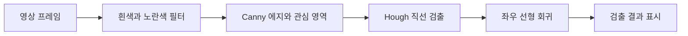

# Graduation Vision

도로 영상의 차선 인식, 웹캠 객체 인식, ROS 카메라 기반 차선 인식을 모은 졸업 프로젝트입니다. 세 프로그램은 각각 독립적으로 실행하며, 입력 영상에서 검출 결과를 확인하는 데 초점을 맞췄습니다.

[](https://github.com/leeahwi/graduation-vision/actions/workflows/verify.yml)

[릴리스 다운로드](https://github.com/leeahwi/graduation-vision/releases/tag/v1.0.0) | [빌드와 실행](#빌드와-실행) | [ROS 차선 인식](#ros-차선-인식) | [원본 출처](docs/PROVENANCE.md)

## 프로그램 구성

| 프로그램 | 입력 | 처리 방식과 출력 |
| --- | --- | --- |
| [영상 차선 인식](lane-detection/) | 주행 영상 파일 | OpenCV로 좌우 차선을 찾아 화면과 영상 파일에 표시 |
| [객체 인식](object-detection/) | 웹캠 0번 | YOLOv5s ONNX 모델을 OpenCV DNN으로 실행해 물체 이름과 상자 표시 |
| [ROS 차선 인식](ros-lane-detection/) | ROS 1 카메라 토픽 | 차선 위치를 계산해 수치와 진단 영상 토픽으로 발행 |

영상 차선 인식은 색상 필터와 에지 검출로 후보를 좁히고, 직선 검출과 회귀로 좌우 차선을 구합니다.



## 빌드와 실행

C++ 프로그램은 CMake 3.16 이상, C++17 컴파일러, OpenCV와 GSL이 필요합니다. 다음은 Ubuntu 22.04 기준입니다.

```bash
sudo apt-get update
sudo apt-get install build-essential cmake libopencv-dev libgsl-dev

git clone https://github.com/leeahwi/graduation-vision.git
cd graduation-vision
python3 scripts/fetch-release-data.py
cmake -S . -B build -DCMAKE_BUILD_TYPE=Release
cmake --build build --parallel 2
```

`fetch-release-data.py`는 릴리스의 실험 영상과 모델을 내려받아 SHA-256을 확인하고 원래 경로에 복원합니다. 기존 파일이 있으면 릴리스 원본으로 교체합니다. Ubuntu 22.04 x86_64에서는 [릴리스의 빌드 파일](https://github.com/leeahwi/graduation-vision/releases/tag/v1.0.0)도 사용할 수 있으며, 실행 시 OpenCV와 GSL이 필요합니다.

### 영상에서 차선 찾기

저장소 루트에서 실행합니다.

```bash
./build/lane-detection/Live_LaneDetection lane-detection/challenge.mp4
```

검출 결과를 창에 표시하고 현재 디렉터리에 `live.avi`와 `img_annota1ted.jpg`를 기록합니다. 화면을 표시할 수 있는 환경과 XVID 인코더가 필요하며, `Esc`로 종료합니다.

### 웹캠에서 물체 찾기

```bash
./build/object-detection/Live_ObjectDetection object-detection/coco.names object-detection/yolov5s.onnx
```

카메라 0번을 열고 COCO 클래스의 물체를 표시합니다. 카메라 권한이 필요하며 결과 창에서 키를 누르면 종료합니다. 후처리는 포함된 YOLOv5s 모델의 `25200 × 85` 출력 형상을 전제로 하므로 다른 모델을 쓰려면 후처리도 맞춰야 합니다.

## ROS 차선 인식

ROS 1과 catkin이 준비된 Linux 환경에서 별도로 빌드합니다. 원본은 ROS Melodic 기준이며, Python과 `cv_bridge`는 사용하는 ROS 배포판에 맞춰 준비해야 합니다.

저장소 루트에서 다음 명령을 실행합니다.

```bash
mkdir -p ~/catkin_ws/src
ln -s "$PWD/ros-lane-detection" ~/catkin_ws/src/hg_lineDetection
cd ~/catkin_ws
catkin_make
source devel/setup.bash
roslaunch hg_lineDetection lineDetection.launch
```

카메라 노드는 별도로 실행해야 합니다. 기본 입력은 `/stereo/left/image_raw`이며, 다른 토픽은 roslaunch 명령 뒤에 `/stereo/left/image_raw:=/your/camera/topic`을 붙여 연결합니다.

| 실행 파일 | 수치 출력 토픽 |
| --- | --- |
| `lineDetection.launch` | `lane_pub` |
| `lineDetectionHough.launch` | `lane_pub` |
| `lineDetectionDiff.launch` | `lane_left`, `lane_right` |

수치 출력은 `std_msgs/Float64`입니다. 진단 영상은 `/lane/raw_image`, `/lane/bev_image`, `/lane/filter_image`, `/lane/left_roi`, `/lane/right_roi`로 발행합니다. 원본의 640×480 입력 가정이 남아 있고, launch의 `publish`, `save` 파라미터는 현재 코드에서 읽지 않습니다.

## 코드와 검증 범위

- [lane-detection/main.cpp](lane-detection/main.cpp)의 `main`에서 차선 인식 단계를 따라갈 수 있습니다.
- [object-detection/main.cpp](object-detection/main.cpp)는 전처리, 추론, 후처리와 화면 표시를 담고 있습니다.
- [ros-lane-detection/src/](ros-lane-detection/src/)에는 ROS 노드의 기본, Diff, Hough 구현이 있습니다.
- [GitHub Actions](.github/workflows/verify.yml)는 C++ 빌드, 누락 입력 처리, Python 문법과 ROS XML 구문, 릴리스 데이터 체크섬을 검사합니다.

CI는 화면 재생, 웹캠 추론, ROS 빌드와 로봇 연결까지 확인하지 않습니다. 원본 인식 알고리즘을 유지했기 때문에 고정 영상 크기와 모델 출력 형상, Python 버전에 따른 나눗셈 차이 등은 실행 환경에서 확인해야 합니다.

## 이력과 이용 조건

2022~2023년 졸업 과제의 원본 저장소 세 개를 2026년 10월에 통합했습니다. 원본 Git 이력과 `source/<원본 저장소명>` 태그를 보존하고 공통 빌드와 릴리스 도구를 추가했습니다. 영상과 모델은 현재 트리에서 릴리스로 옮겼지만 과거 커밋에는 남아 있습니다.

차선 인식은 [georgesung/road_lane_line_detection](https://github.com/georgesung/road_lane_line_detection)을 webnautes가 수정한 코드를 바탕으로 합니다. 원본 출처와 ROS maintainer 표기를 유지했습니다. 저장소 전체에 적용되는 통일된 라이선스는 없으며, 코드·모델·영상의 재사용 조건은 각각의 원출처를 확인해야 합니다.

- [출처와 통합 범위](docs/PROVENANCE.md)
- [실행 파일 안내](docs/releases/BINARY-README.md), [ROS 소스 안내](docs/releases/ROS-README.md)
- [릴리스 데이터와 체크섬 목록](docs/releases/data-manifest.json)
