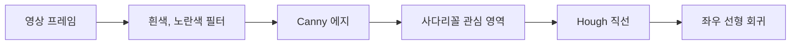

# graduation-vision

[](https://github.com/leeahwi/graduation-vision/actions/workflows/verify.yml)

도로 영상에서 차선을 찾고 웹캠 영상에서 물체를 찾는 졸업 프로젝트 세 개를 한곳에 모은 저장소입니다. 주행 영상을 넣으면 좌우 차선을 그린 영상이, 웹캠을 켜면 물체 이름과 테두리 상자를 그린 화면이, ROS 카메라 토픽을 넣으면 차선 중앙이 화면 가운데에서 벗어난 정도를 나타내는 값이 나옵니다.

**기간** 2022.10 – 2023.06 (원본 커밋 기준)

## 소개

세 프로그램은 졸업 과제로 만들었고, 원래는 저장소가 따로 있었습니다. 2026년 10월에 원본 커밋 9개를 병합 이력으로 살린 채 한 저장소로 합치고, 공통 빌드와 릴리스를 더했습니다. 세 프로그램은 서로 이어지지 않고 따로 실행됩니다.

영상 차선 인식은 프레임에서 흰색과 노란색 선만 골라 직선으로 맞추는 고전 영상 처리 방식입니다. 객체 인식은 ONNX 형식의 YOLOv5s 모델을 OpenCV DNN으로 돌립니다. ROS는 로봇 프로그램끼리 토픽이라는 이름 붙은 통로로 메시지를 주고받게 해 주는 프레임워크이고, ROS 차선 인식은 카메라 토픽을 받아 계산한 값을 다른 노드에 보냅니다.

## 주요 기능

영상 차선 인식은 프레임마다 아래 순서로 차선을 찾습니다.



- **영상 차선 인식**: `lane-detection/`의 C++ 프로그램입니다. 찾은 직선을 기울기로 좌우로 나누고 선형 회귀로 한 줄씩 맞춰 원본 위에 그립니다. 결과는 화면 창과 `live.avi`로 나옵니다.
- **웹캠 객체 인식**: `object-detection/`의 C++ 프로그램입니다. 카메라 0번 영상에서 COCO 클래스 80종을 찾아 이름과 상자를 그립니다.
- **ROS 차선 인식**: `ros-lane-detection/`의 Python ROS 1 노드입니다. 카메라 영상을 위에서 내려다본 시점으로 바꾸고, 좌우 관심 영역에서 Hough 직선과 RANSAC으로 차선을 맞춥니다. 기본, Diff, Hough 세 변형이 있습니다.
- **릴리스 배포**: GitHub Actions가 Ubuntu 22.04에서 C++ 두 프로그램을 빌드하고, 실행 파일과 원본 영상, 모델, ROS 소스를 SHA-256 목록과 함께 릴리스로 묶습니다.

## 빠른 시작

Ubuntu 22.04 x86_64라면 [v1.0.0 릴리스](https://github.com/leeahwi/graduation-vision/releases/tag/v1.0.0)에서 실행 파일, 원본 실험 영상 5개, 모델 압축을 받아 바로 돌릴 수 있습니다. 실행 파일은 시스템 OpenCV와 GSL에 동적으로 연결되므로, 압축 안의 README를 따라 `libopencv-dev`와 `libgsl-dev`를 설치하면 됩니다.

다른 운영체제나 CPU에서는 소스로 빌드합니다. CMake 3.16 이상, C++17 컴파일러, OpenCV, GSL이 있어야 합니다.

```bash
sudo apt-get update
sudo apt-get install build-essential cmake libopencv-dev libgsl-dev

git clone https://github.com/leeahwi/graduation-vision.git
cd graduation-vision
python3 scripts/fetch-release-data.py    # 릴리스의 영상과 모델을 받아 SHA-256을 확인하고 제자리에 풂
cmake -S . -B build -DCMAKE_BUILD_TYPE=Release
cmake --build build --parallel 2

./build/lane-detection/Live_LaneDetection lane-detection/challenge.mp4
./build/object-detection/Live_ObjectDetection object-detection/coco.names object-detection/yolov5s.onnx
```

차선 인식은 실행한 폴더에 `live.avi`와 `img_annota1ted.jpg`를 남기고, `ESC`를 누르면 끝납니다. 객체 인식은 아무 키나 누르면 끝납니다. 둘 다 화면 창을 띄울 수 있어야 하고, 차선 인식에는 XVID 인코더가, 객체 인식에는 카메라 권한이 필요합니다. OpenCV를 따로 설치했다면 구성 명령에 `-DOpenCV_DIR=/path/to/opencv/lib/cmake/opencv4`를 더하면 됩니다.

### ROS 차선 인식

ROS 1과 catkin이 준비된 Linux에서 저장소 루트를 기준으로 돌립니다. 패키지 이름은 원본의 `hg_lineDetection`을 유지합니다.

```bash
mkdir -p ~/catkin_ws/src
ln -s "$PWD/ros-lane-detection" ~/catkin_ws/src/hg_lineDetection
cd ~/catkin_ws && catkin_make && source devel/setup.bash
roslaunch hg_lineDetection lineDetection.launch    # 변형은 lineDetectionDiff.launch, lineDetectionHough.launch
```

카메라 노드는 따로 띄워야 하고, 기본 입력 토픽은 `/stereo/left/image_raw`입니다. 다른 토픽을 쓰려면 roslaunch 명령 뒤에 `/stereo/left/image_raw:=/your/camera/topic`을 붙이면 됩니다. 원본은 ROS Melodic용으로 설명되어 있어, Python과 `cv_bridge`는 쓰는 ROS 배포판에 맞춰 준비해야 합니다.

| 변형 | 값 출력 (`std_msgs/Float64`) | 진단 영상 |
| --- | --- | --- |
| 기본, Hough | `lane_pub` | `/lane/raw_image`, `/lane/bev_image`, `/lane/filter_image`, `/lane/left_roi`, `/lane/right_roi` |
| Diff | `lane_left`, `lane_right` | 기본과 같음 |

진단 영상은 원본의 640×480 영상 크기를 전제로 합니다. launch 파일의 `publish`, `save` 파라미터는 지금 코드에서 읽지 않습니다.

## 구조

C++ 두 프로그램은 루트 `CMakeLists.txt`로 함께 빌드하고, ROS 패키지는 catkin 작업 공간에서 따로 빌드합니다.

```text
lane-detection/       영상 차선 인식 main.cpp
object-detection/     웹캠 객체 인식 main.cpp, COCO 클래스 목록
ros-lane-detection/   ROS 1 패키지 hg_lineDetection, 노드 3개와 launch 파일 3개
scripts/              릴리스 데이터 받기, 릴리스 묶기
docs/                 원본 출처와 통합 내역, 릴리스 안내문
.github/workflows/    빌드, 체크섬 검사, 초안 릴리스
```

코드를 처음 본다면 `lane-detection/main.cpp`의 `main` 함수에 1부터 9까지 번호를 붙인 주석을 따라가면 차선 인식 흐름이 보입니다.

## 지금 상태

GitHub Actions는 C++ 두 프로그램의 Ubuntu 빌드, 입력 파일이 없을 때 오류로 끝나는 동작, Python 문법과 ROS XML 구문, 원본 데이터 체크섬을 확인합니다. `v*` 태그를 push하면 초안 릴리스를 준비합니다. 화면 재생, 웹캠 추론, ROS 빌드와 실제 로봇 연결은 이번 통합에서 테스트하지 않았습니다.

인식 알고리즘과 임계값은 원본에서 바꾸지 않았습니다. 그래서 Python 2와 3의 나눗셈 차이, 고정된 영상 크기와 검출 개수 같은 제약이 남아 있습니다. 객체 인식 후처리는 들어 있는 모델의 출력 형상 25200 × 85를 전제로 하므로, 다른 YOLO 모델로 바꾸려면 후처리도 함께 고쳐야 합니다.

영상과 모델은 지금 파일 목록에서 빼 릴리스로 옮겼지만 과거 커밋에는 남아 있습니다. 전체 이력을 clone하면 크기는 줄지 않습니다.

## 문서

- [원본 이력과 통합 내역](docs/PROVENANCE.md): 원본 저장소 3개, 통합하며 바꾼 범위, 외부 출처
- [원본 기준 커밋](docs/source-repositories.json): 저장소별 기준 커밋과 커밋 수
- [실행 파일 안내](docs/releases/BINARY-README.md), [ROS 소스 안내](docs/releases/ROS-README.md): 릴리스 압축에 들어가는 안내문
- [데이터 목록](docs/releases/data-manifest.json): 영상과 모델 압축, 개별 파일의 SHA-256

## 만든 사람

졸업 과제로 만든 세 프로그램을 2026년 10월에 제가 한 저장소로 합쳤습니다. 원본 저장소 Live_LaneDetection, Live_ObjectDetection, RosLaneDetection의 커밋은 이 저장소 이력에 남아 있고, 각 기준점에 `source/<원본 저장소명>` 태그를 붙였습니다.

차선 인식 `main.cpp`는 [georgesung/road_lane_line_detection](https://github.com/georgesung/road_lane_line_detection)을 webnautes가 고친 코드를 바탕으로 했고, 이 출처 표기와 ROS 패키지의 maintainer 표기는 원본대로 뒀습니다. 원본에 통일된 라이선스가 없고 ROS manifest의 라이선스도 `TODO`라서, 저장소 전체에 새 라이선스를 붙이지 않았습니다. 외부 코드, 모델, 영상의 재사용 조건은 각 원출처에서 확인해야 합니다.
